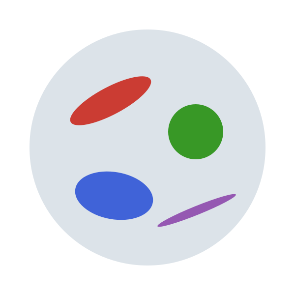

{.jfb-page-logo}

**MeanFieldHomogenization.jl** predicts the effective elastic, transport and viscoelastic properties
of a heterogeneous material from the properties, shapes, orientations and volume fractions
of the phases of its microstructure. All the ingredients — inclusion morphologies, localization
tensors and homogenization schemes — live under a common abstraction hierarchy with a shared
numerical core and a central dispatch mechanism. A microstructure can also serve as the
constitutive law at each Gauss point of a finite-element computation.
Part of the **[MicroPoroChemoMechanics](mpcm.qmd)** ecosystem, built on **[TensND.jl](tensnd.qmd)**.

### Key features

- **Hill polarization tensors** — ellipsoidal inclusions and infinite cylinders, 2D and 3D,
  isotropic, anisotropic or transversely isotropic coaxial matrices
- **Cracks** — crack-opening-displacement tensor, compliance contribution, stress and
  displacement intensity factors for elliptic and ribbon cracks
- **Transport** — second-order Hill tensor with a closed form for any matrix anisotropy
- **Layered inclusions** — `n`-layer composite spheres and confocal spheroids with imperfect
  interfaces (perfect, spring, membrane, Kapitza, surface-conductive)
- **Homogenization schemes** — bounds, dilute, Mori–Tanaka, Maxwell, Ponte Castañeda–Willis,
  self-consistent and asymmetric self-consistent, differential; the cluster model and the
  equivalent inclusion method for interacting particles
- **Aging linear Volterra behavior** — aging viscoelasticity and hereditary conduction as
  time-domain Volterra operators with structured ISO/TI/orthotropic kernel storage, in every
  scheme; and, for non-aging behavior, the Laplace–Carson route with autodiff-capable numerical
  inversion
- **Open inclusion contract** — any morphology joins every scheme through one of three entry
  gates (Hill tensor, localization tensors, contribution tensors), whatever computed the
  answer; the two below are its current tenants, not its limits
- **Finite-element inclusions** — Eshelby problem solved numerically (3-D elliptical crack,
  sphere with an off-center core) behind a two-backend contract
- **Neural-surrogate inclusions** — a trained multilayer perceptron standing in for the
  Eshelby response, differentiable with respect to the morphology itself and orders of
  magnitude cheaper than the finite-element solve it replaces
- **Prototyping-oriented** — `ForwardDiff` sensitivities with respect to fractions, moduli and
  inclusion geometry, plus symbolic simplification via `SymPy` and `Symbolics`

### Try it in the browser

The simplest case the package handles: an isotropic matrix holding isotropic spherical
inclusions. The chart gives the effective Young's modulus as the inclusions take up more of the
volume, on a logarithmic or a linear scale; drag across it to read the values at a given
fraction. The boxes under it choose the curves: the Voigt–Reuss bounds and the tighter
Hashin–Shtrikman ones, which no isotropic mixture of these two phases can leave; the dilute
estimates, on the stiffness or on the compliance, which hold at small fractions only; and the
Mori–Tanaka, three-phase (generalized self-consistent), differential and self-consistent
estimates. For spheres the Maxwell and Ponte Castañeda–Willis schemes coincide with
Mori–Tanaka, and the asymmetric self-consistent scheme with the self-consistent one. Every
curve is a closed form, a fixed point or a short differential equation, computed in your
browser rather than by the package, and checked against the package to ten significant digits.

::: {#hom-widget}
*The interactive chart needs JavaScript.*
:::

### Installation

`MeanFieldHomogenization.jl` is registered in Julia's General registry:

```julia
using Pkg
Pkg.add("MeanFieldHomogenization")
```

Optional package extensions activate on weak dependencies:
[DECUHR.jl](https://github.com/MicroPoroChemoMechanics/DECUHR.jl) with
Integrals.jl (adaptive cubature backend), NonlinearSolve.jl (SciML fixed-point algorithms for
the self-consistent schemes), SymPy.jl and Symbolics.jl (symbolic computation),
MittagLeffler.jl (closed-form time values of the fractional rheological models), two
finite-element backends — Ferrite.jl + Gmsh.jl or Gridap.jl + GridapGmsh.jl — and Lux.jl with
Optimisers.jl and Zygote.jl to train your own surrogates. Loading a shipped surrogate needs none of them:
the trained network carries no machine-learning dependency.

### Documentation

Full documentation is available at
[MicroPoroChemoMechanics.github.io/MeanFieldHomogenization.jl](https://MicroPoroChemoMechanics.github.io/MeanFieldHomogenization.jl/stable/),
including a gallery of complete micromechanical models in the
[Applications](https://MicroPoroChemoMechanics.github.io/MeanFieldHomogenization.jl/stable/applications/)
section — hydrating cement paste, chloride diffusivity, the interfacial transition zone in
concrete, quasi-brittle strength, the elastic limit of concrete, the friction of a granular
medium, the strength of a sandstone, bituminous mixtures and aging creep.

### Links

[](https://MicroPoroChemoMechanics.github.io/MeanFieldHomogenization.jl/stable/)
[](https://github.com/MicroPoroChemoMechanics/MeanFieldHomogenization.jl)
[](https://doi.org/10.5281/zenodo.21884243)
